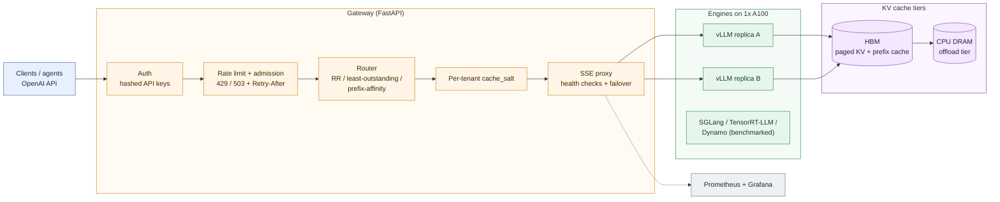
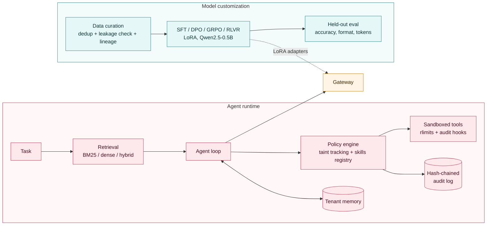

# InferScale-X

An LLM serving platform built and measured end to end on **one NVIDIA A100 (40 GB, Google Colab)**, with the Kubernetes parts on a MacBook Air M3 using kind. It covers:
- an OpenAI-compatible gateway with KV-aware routing and tenant isolation
- KV-cache tiering and pressure experiments
- custom Triton kernels
- an engine comparison: vLLM, SGLang, TensorRT-LLM and Dynamo
- sandboxed agents
- SFT, DPO, GRPO and RLVR fine-tuning

Every number below comes from a JSON report in `benchmarks/results/` or `training/runs/`, with an `env.json` recording GPU, driver and library versions. Repeated runs report mean ± 95% CI over 3 repeats. Failed experiments are documented in `docs/negative-results.md`.

---

## Highlights

| Result | Number |
|---|---|
| Fault injection found 3 real gateway bugs; after the fixes, a replica crash is detected in **0.23 s** | 3 / 720 requests failed |
| Closed a **cross-tenant KV-cache timing leak** with per-tenant `cache_salt` | other tenant's cached tokens: >0 → 0 |
| KV capacity below the working set → **9× worse TTFT**; a CPU-DRAM KV tier recovers it | TTFT 137 → 90 ms with the CPU tier |
| Triton fused add+RMSNorm **beats torch.compile and vLLM's CUDA kernel** at large shapes | 456 µs vs 570 / 819 µs |
| Prefill next to decode makes decode stutter | ITL p99 4.7 → 110 ms |
| **RLVR** took a 0.5B model from 0.345 to **0.955** accuracy with no demonstrations; the same setup with a format-only reward was **reward-hacked** | 0.005 accuracy, 4-token answers |
| Diagnosed and fixed a **DPO collapse** | 0.015 → 0.980 |

---

## Scope

| Area | What's in this repo |
|---|---|
| **vLLM** | Primary backend: continuous batching, paged KV cache, prefix caching, chunked prefill |
| **SGLang** | Same workloads as vLLM, separate runtime |
| **TensorRT-LLM** | `trtllm-serve` benchmarked at default config |
| **NVIDIA Dynamo** | Single-node frontend + vLLM worker (etcd, NATS), benchmarked through Dynamo |
| **Triton Inference Server** | Model-repository reference design (vLLM backend), for a Docker GPU host |
| **Disaggregated inference** | Prefill/decode interference measured, KV transfer cost model, vLLM P/D connector attempts |
| **NIXL** | KV-transfer benchmark + vLLM `NixlConnector` attempt (failed to start on one GPU) |
| **Multi-tier KV caching** | HBM prefix cache → CPU DRAM tier; pressure sweep; LMCache remote tier attempted |
| **Speculative decoding** | Draft-model and n-gram speculation, HF and vLLM |
| **Quantization** | BF16 vs AWQ-INT4 vs GPTQ-INT8 vs FP8 |
| **Custom kernels** | Triton FlashAttention-style forward + fused add/RMSNorm |
| **Kubernetes** | kind cluster: scheduling, anti-affinity, pod-kill recovery, HPA scaling, NetworkPolicy; Helm chart |
| **Compute fabrics (RDMA/InfiniBand)** | Fabric-aware sizing in the capacity model, built on a measured PCIe transfer model |
| **Agent design** | RAG, tool execution, tenant memory, multi-step loop through the gateway |
| **Sandboxing** | Isolated subprocess, rlimits, RSS watchdog, PEP 578 audit hooks |
| **Evaluation** | Retrieval (MRR/nDCG), agent vs RAG, latency, safety/attack suites |
| **Skills and governance** | Versioned hash-locked skills, permission engine, taint tracking, hash-chained audit trail |
| **SFT, DPO, GRPO, RLVR** | LoRA on Qwen2.5-0.5B with held-out eval |
| **Data curation** | Dedup, train/eval leakage check, SHA-256 dataset lineage |
| **Grove** | Evaluation plan for gang-scheduled prefill/decode groups on GPU Kubernetes |
| **Solutions architecture** | Partner deployment guide, ADRs, runbooks, threat model, capacity/cost model, live demo endpoint |
| **Open source** | MIT-licensed public repo, reproducible notebooks, generated results page, contribution guide |

---

## Architecture

**Serving path**



**Agents and model customization**



**Request path:** a client or the agent calls the gateway with an API key. The gateway checks the key, applies per-tenant rate limits and admission, then picks a replica. It adds the tenant's cache salt and streams the response back. Each vLLM replica keeps paged KV in HBM, and blocks that don't fit spill to the CPU DRAM tier.


---

## 1. Gateway: overhead and reliability

**Overhead.** Qwen2.5-1.5B on vLLM 0.31, `chat_short`, 300 requests × 3 repeats.

| Path | tok/s | TTFT p50 | TPOT p50 |
|---|---|---|---|
| Direct to vLLM | 5,078 | 122 ms | 5.1 ms |
| Through gateway | 5,060 | 130 ms | 5.0 ms |

Throughput is the same within noise, and the gateway adds about 8 ms to TTFT. An 8-test live suite against real vLLM passed: stream/non-stream parity, determinism, usage accounting and limits.

**Replica crash (Colab, real vLLM).** Two replicas, one killed with `SIGKILL` under load:
- The gateway marked it unhealthy in **0.23 s**.
- **3 / 720** requests failed: the ones mid-stream on the dead replica.
- The replica rejoined after 55.6 s.
- Overload returned fast 429/503 with `Retry-After` instead of queueing.

**Kubernetes (kind, 3 nodes).** Anti-affinity, HPA, Calico NetworkPolicy, pod-kill under load. The first run failed **6 / 62** requests and exposed three gateway bugs:
1. Retries caught only 4 specific network exceptions, so some failures surfaced as bare 500s. They now catch all transport errors.
2. A backend that accepted connections but never answered hung requests forever. Fixed with a separate idle-read timeout, so slow-but-alive streams still work.
3. There was no last-resort handler, so clients could get an HTML 500. Every error is now JSON.

After the fixes: **4 / 677** failed on a gateway pod kill, **1,119 / 1,125** overall, with failure detected in about 2 s. A "hanging backend" mode in the mock server keeps these as regression tests.

---

## 2. KV-cache engineering

**Prefix caching**, on a shared-prefix workload:

| | tok/s | TTFT p50 | TPOT p50 |
|---|---|---|---|
| Off | 1,330 | 278 ms | 19.7 ms |
| On | **2,677** | **183 ms** | **8.4 ms** |

**KV pressure.** The working set is 32 prefixes × 2,000 tokens = 4,000 blocks. KV capacity was capped with `--num-gpu-blocks-override`. The first attempt lowered `gpu_memory_utilization` instead and created no pressure at all: even 0.3 × 40 GB holds the whole working set.

| KV blocks | Cached-token fraction | TTFT p50 | tok/s |
|---|---|---|---|
| 8,000 | 0.57 | 172 ms | 2,320 |
| 3,000 | 0.31 | 360 ms | 1,642 |
| 1,200 | 0.14 | **1,552 ms** | 1,018 |

**CPU-DRAM tier.** GPU KV was capped below the working set:

| Setup | tok/s | TTFT p50 |
|---|---|---|
| No prefix cache | 629 | 183 ms |
| HBM only | 760 | 137 ms |
| HBM + CPU tier (vLLM native offloading) | **1,038** | **90 ms** |

**Move or recompute?** For an 8k-token prompt (224 MiB of KV), prefill took **190 ms** and a CPU round trip took **37 ms** (pinned host↔GPU at about 12.4 GB/s). At 256 tokens it was 31 ms vs 1.5 ms, where fixed per-call overhead dominates. A pure bandwidth model was off by about 45% at small sizes and about 3% at 8k tokens.

**Cross-tenant leak.** Prefix caching is shared. If tenant A sends a private document and tenant B sends the same text, B gets cached tokens and a faster TTFT, which is a timing side channel. The gateway now injects `cache_salt = HMAC(secret, tenant_id)` and strips any client-supplied salt:
- Tenant B gets **0** cached tokens.
- Tenant A keeps its own cache hits.

The tradeoff: tenants no longer share hits on identical public prefixes.

---

## 3. Routing: a prediction that failed

Prefix-affinity routing (rendezvous hashing, with an imbalance fallback) was expected to win on a shared-prefix workload. Setup: 2 replicas on one GPU.

| Policy | tok/s | TTFT p50 |
|---|---|---|
| Round-robin | 1,662 | **115 ms** |
| Least-outstanding | 1,740 | 189 ms |
| Prefix-affinity | 1,673 | 174 ms |

Prefix-affinity was **about 50% worse** on TTFT. Only 8 prefixes (about 16k tokens of KV) existed, so both replicas cached all of them. Affinity just concentrated load on one replica, and both replicas share one GPU anyway. Affinity should pay off once the prefixes exceed one replica's cache, or with separate GPUs.

---

## 4. Prefill/decode interference

This is the problem disaggregated serving solves. A steady decode stream ran while long-prefill requests kept arriving:

| Chunked-prefill budget | TPOT p50 alone → noisy | ITL p99 alone → noisy |
|---|---|---|
| 512 | 4.16 → 7.5 ms | 4.7 → 22.6 ms |
| 2,048 | 4.16 → 8.1 ms | 4.8 → 44.8 ms |
| 8,192 | 4.17 → 8.3 ms | 4.8 → **110 ms** |

The median barely doubles, but the tail gets 23× worse. Bigger chunks mean longer stalls. The first version of this test showed no effect because the noise finished before most probe tokens. It was fixed by keeping the noise running until the probe ended.

A real prefill/decode split needs two GPUs. vLLM's `NixlConnector` failed to initialize on one GPU, and `P2pNcclConnector` isn't supported in vLLM 0.31. Both attempts are logged.

---

## 5. Custom Triton kernels

**Fused add + RMSNorm.** 21/21 correctness cases pass, and it's also verifiable on CPU with `TRITON_INTERPRET=1`.

| Shape | Triton (mine) | torch eager | torch.compile | vLLM CUDA |
|---|---|---|---|---|
| 1 × 1,536 | 85 µs | 170 µs | 108 µs | **58 µs** |
| 16,384 × 1,536 | **208 µs** | 1,079 µs | 240 µs | 322 µs |
| 8,192 × 8,192 | **456 µs** | 2,739 µs | 570 µs | 819 µs |

vLLM's kernel wins at small shapes, where launch overhead dominates. Mine wins at large shapes.

**FlashAttention-style forward** (tiled, online softmax). 24/24 correctness cases pass.

| Case | Triton (mine) | PyTorch SDPA | Naive |
|---|---|---|---|
| B4 H16 N2048 D64 | 135.8 TFLOP/s | 159.8 | 11.3 |
| B1 H32 N8192 D128, causal | 64.0 | 182.7 | 8.0 |

It's 10–30× faster than naive attention, but only 64–91% of SDPA at head_dim 64 and 35–44% at 128. The tiles are fixed with no autotuning, and register pressure at D=128 cuts occupancy. `@triton.autotune` is the next step.

---

## 6. Quantization

| Format | c1 tok/s | c32 tok/s | c32 TTFT p50 |
|---|---|---|---|
| BF16 | 225 | 4,338 | **152 ms** |
| AWQ INT4 | **332** | **4,579** | 220 ms |
| GPTQ INT8 | 295 | 4,300 | 211 ms |
| FP8 (weight-only) | 291 | 4,319 | 220 ms |

At concurrency 1, decode is memory-bound, so smaller weights give a straight win (AWQ +48%), even FP8 on an A100 with no FP8 tensor cores. At concurrency 32 the gain mostly disappears and TTFT gets worse, because prefill is compute-bound and pays the dequantization cost.

---

## 7. Engine comparison

Same GPU, model and workloads; each engine in a fresh runtime.

| Engine | tok/s | TTFT p50 | TPOT p50 |
|---|---|---|---|
| vLLM 0.31 | **5,087** | 115 ms | 5.1 ms |
| SGLang 0.5.21 | 4,859 | 163 ms | **4.9 ms** |
| Dynamo frontend → vLLM | 4,989 | 122 ms | 5.2 ms |
| TensorRT-LLM 1.2.1, default config | 1,715 | 118 ms | 17.3 ms |

- vLLM and SGLang are within about 5%, which isn't significant across runtimes.
- Dynamo's control plane (etcd + NATS + frontend) costs about 2% throughput and 7 ms TTFT on a single node.
- TensorRT-LLM ran at **defaults**: PyTorch backend, no CUDA-graph or batch tuning. Its TTFT matches vLLM and the whole gap is per-token decode, so this measures configuration, not the engine's ceiling.

---

## 8. Speculative decoding: a negative result

Target Qwen2.5-3B, draft Qwen2.5-0.5B (matching vocabularies; the 7B uses a different one).
- **Hugging Face, batch 1:** 2.6–4.6 tokens accepted per target pass, but no speedup (25.8 vs 24.3 tok/s). Eager HF is launch-bound, and the 24-layer draft costs about ⅔ of a 36-layer target step.
- **vLLM:** draft-model k=4 dropped c1 throughput from **143 to 42 tok/s**, and n-gram k=4 to 74.

The likely cause is the synthetic workload: random-word prompts with `ignore_eos` forcing 256 tokens give the draft nothing predictable. This is unconfirmed, because the acceptance rate wasn't captured. Next step: natural prompts and logged acceptance.

---

## 9. Secure agents

**Retrieval** (32 labelled queries):

| Retriever | hit@1 | MRR@10 | nDCG@5 |
|---|---|---|---|
| BM25 | **0.91** | **0.94** | **0.93** |
| Dense (MiniLM) | 0.72 | 0.83 | 0.85 |
| Hybrid (RRF) | 0.88 | 0.92 | 0.92 |

BM25 won because the queries reuse exact doc terms. The benchmark is small and author-written, so it's easy and biased.

**Agent vs RAG.** Both scored 83% on Qwen2.5-7B, because most tasks need one passage. The agent's value showed up as governance:
- **Sandbox:** subprocess with per-limit rlimits, an RSS watchdog and PEP 578 audit hooks.
- **Skills:** hash-locked and versioned.
- **Policy engine:** taint tracking, so retrieved text can't trigger privileged tools.
- **Audit log:** hash-chained.

**All attacks were blocked**, from both the scripted adversary and the live model. The suite covered prompt injection, unauthorized tools, sandbox escape, a memory bomb and cross-tenant memory.

**A bug the suite caught.** On macOS, `setrlimit(RLIMIT_AS)` raises. All limits were set in one `try` block, so one failure silently skipped the rest. Each limit is now set separately, with an RSS watchdog as a backstop.

---

## 10. Fine-tuning: SFT, DPO, GRPO, RLVR

Qwen2.5-0.5B-Instruct with LoRA, on verifiable arithmetic word problems. Splits: 2,000 SFT / 1,000 DPO / 1,000 RL / 200 eval, with 0 train/eval overlap and SHA-256 lineage.

| Model | Accuracy | Format | Output tokens |
|---|---|---|---|
| Base | 0.345 | 0.54 | 69 |
| SFT | **0.995** | 1.00 | 28 |
| DPO (plain) | 0.015 | 0.71 | 29 |
| DPO + SFT term | 0.980 | 1.00 | 28 |
| GRPO, format-only reward | 0.005 | 1.00 | **4** |
| RLVR, correctness reward | 0.955 | 1.00 | 53 |
| SFT → DPO + SFT term | 0.970 | 0.995 | 28 |

- **The reward is the spec.** GRPO and RLVR used identical hyperparameters. The format-only reward was hacked into bare `Answer: N` lines, while the correctness reward reached 95.5% with no demonstrations.
- **DPO collapse.** Preference accuracy hit 100% while task accuracy fell to 1.5%, and the log-probability of the chosen answers dropped about 60 nats. The rejected answers matched the chosen ones except for the final number, so DPO widened the margin by pushing *both* down. Adding an SFT loss on chosen (`loss_type=["sigmoid","sft"]`) fixed it.
- **SFT alone was best here.** The gaps between 0.995, 0.98 and 0.97 are within noise for n=200 and one seed. RLVR's answers are about 2× longer, which means about 2× the serving cost.
- Templated data means these are in-distribution results.

---

## What I learned

1. **Make sure an experiment *can* show the effect before trusting "no difference."** Two of mine measured nothing on the first try and looked clean.
2. **Tails, not medians.** Prefill interference barely moved the p50 but made the p99 23× worse.
3. **Fault injection finds what unit tests don't.** All three gateway bugs only appeared when things were killed under load.
4. **In RL, the model optimizes the reward you wrote, not the one you meant.**

---

## Limitations

- **One GPU.** Replicas share the A100, so there's no real cross-GPU KV transfer or prefill/decode split. Triton Inference Server, InfiniBand fabrics and Grove are design docs only.
- **Kubernetes uses CPU mock backends.** It proves scheduling, recovery, HPA and NetworkPolicy, but not GPU scheduling.
- **Small models (0.5–7B), synthetic workloads, templated training data.** The results are about systems behaviour, not quality at scale.
- **3 repeats and one seed per configuration.** Small differences aren't significant.

---

## Tech stack

| Area | Tools |
|---|---|
| Serving | vLLM 0.31, SGLang 0.5.21, TensorRT-LLM 1.2.1, NVIDIA Dynamo |
| Gateway | Python, FastAPI, httpx, Prometheus, OpenTelemetry |
| Kernels | Triton 3.6, PyTorch |
| Agents | rank-bm25, sentence-transformers, SQLite |
| Training | TRL 1.15, PEFT 0.21, transformers 5.18 |
| Infra | Docker Compose, kind, Calico, Helm, Prometheus, Grafana |
| Hardware | A100-SXM4-40GB (Colab Pro), MacBook Air M3 |
| Tests | pytest: 73 unit/integration + 8 live against vLLM |

---

## Run it

```bash
# laptop, no GPU
python -m venv .venv && source .venv/bin/activate
pip install -r requirements/dev.txt
make test          # unit + integration on mock backends
make demo          # gateway + 2 mock backends + load test
make compose-up    # + Prometheus/Grafana in Docker
make k8s           # 3-node kind: scheduling, pod-kill recovery, HPA, NetworkPolicy
```

**Colab A100:** put `InferScale-X.zip` in your Drive root, then run the notebooks in this order. Details are in `docs/RUNNING_ON_COLAB.md`.
1. `notebooks/01_core_platform_A100.ipynb` runs serving, KV, kernels, quantization and agents (about 3–5 h).
2. `02_model_customization_A100.ipynb` runs fine-tuning, in a fresh runtime.
3. `03_alt_engines_and_dynamo.ipynb` runs SGLang, TensorRT-LLM and Dynamo, each in a fresh runtime.

`make results` regenerates `docs/RESULTS.md` and the plots from the result files.
