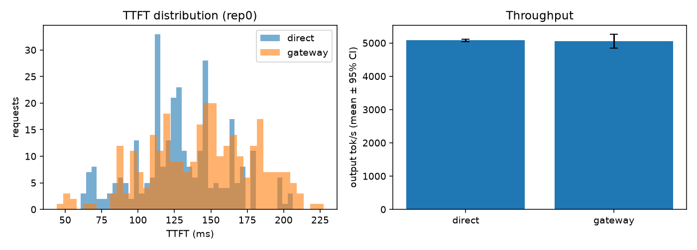
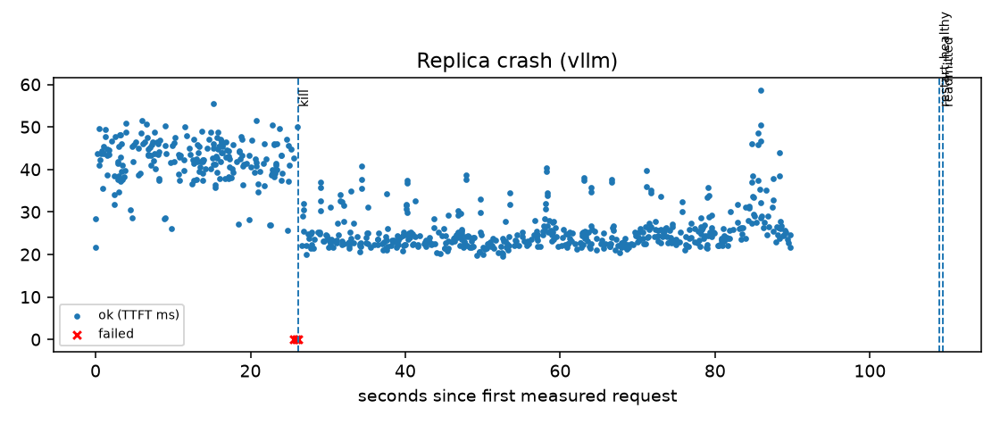
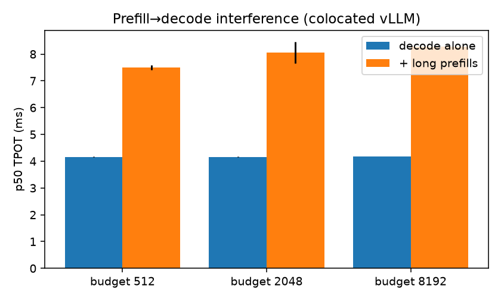
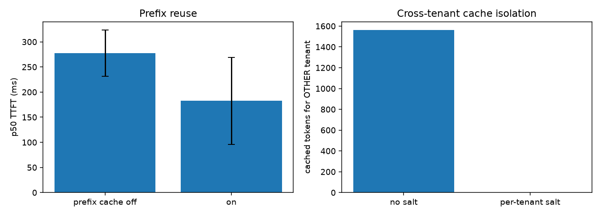
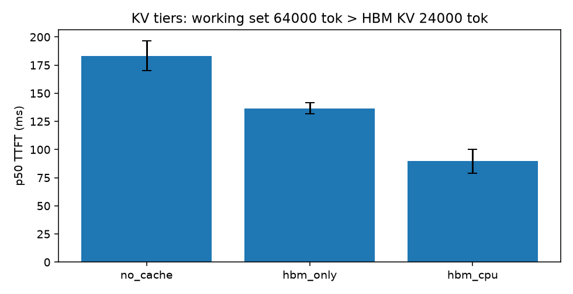
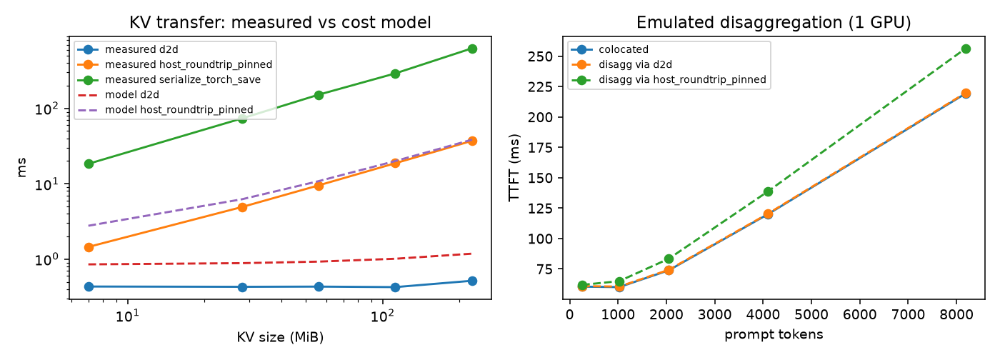
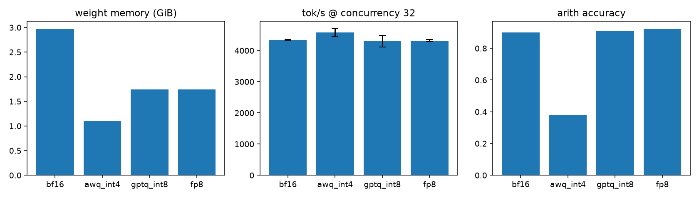
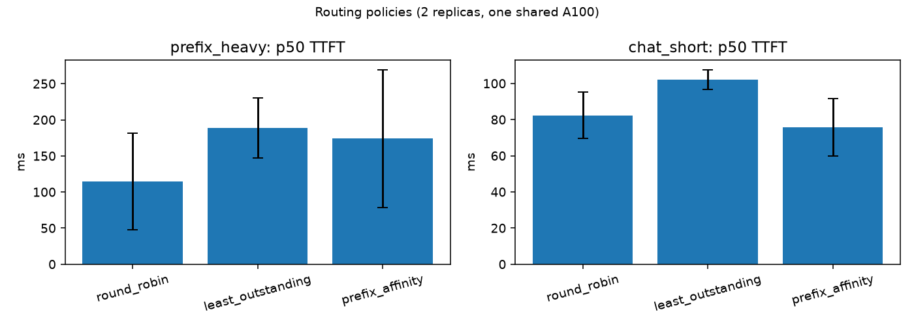
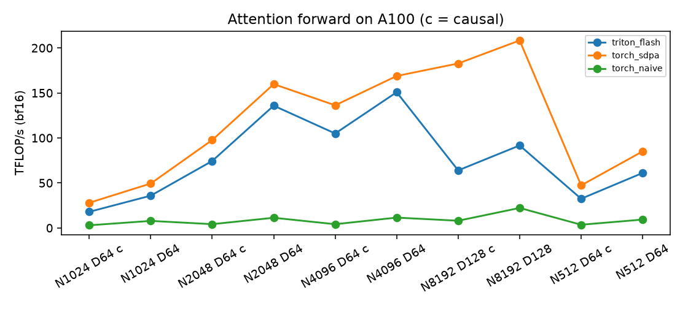
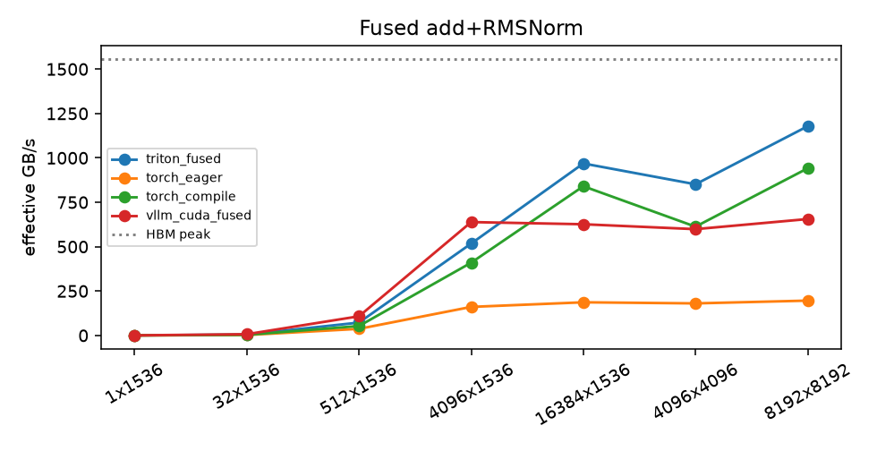

# InferScale-X results

_Generated 2026-10-10 by scripts/publish_results.py. Every number links to its source file; ± is the 95% CI across repeats. Labels: measured unless stated._

**Hardware/software:** NVIDIA A100-SXM4-40GB (40960 MiB), driver 580.82.07, CUDA 13.0, torch 2.13.0, vLLM 0.28.0

## Gateway overhead (vLLM direct vs through gateway)

| | direct | gateway |
|---|---|---|
| output tok/s | 5078 ± 37 | 5060 ± 209 |
| TTFT p50 (ms) | 122.4 ± 11.4 | 130.0 ± 40.2 |
| TTFT change | | +6.3% (no_significant_difference) |

source: `benchmarks/results/baseline/20261010-092402/report.json`

## Routing policies (2 replicas sharing one A100)

| workload | policy | TTFT p50 (ms) | tok/s | vs round-robin (TTFT p50) |
|---|---|---|---|---|
| prefix_heavy | round_robin | 114.6 ± 66.7 | 1662 ± 88 | - |
| prefix_heavy | least_outstanding | 188.5 ± 41.5 | 1740 ± 92 | +64.5% (no_significant_difference) |
| prefix_heavy | prefix_affinity | 173.9 ± 95.5 | 1673 ± 99 | +51.7% (no_significant_difference) |
| chat_short | round_robin | 82.3 ± 12.8 | 2663 ± 19 | - |
| chat_short | least_outstanding | 102.1 ± 5.5 | 2646 ± 27 | +24.1% (regressed) |
| chat_short | prefix_affinity | 75.8 ± 15.9 | 2629 ± 21 | -7.9% (no_significant_difference) |

source: `benchmarks/results/routing/20261010-092925/report.json`

## KV cache

- Prefix caching on vs off, TTFT p50: -34.2% (no_significant_difference)
- Cross-tenant cache leak without salt: True; isolation enforced with gateway salt: True

source: `benchmarks/results/kv_cache/20261010-093938/report.json`

## Multi-tier KV (HBM capped below working set)

| variant | impl | TTFT p50 (ms) | vs HBM-only |
|---|---|---|---|
| no_cache | no_cache | 183.3 ± 13.4 | +34.1% (regressed) |
| hbm_only | hbm_only | 136.7 ± 5.1 | - |
| hbm_cpu | vllm_native_offloading | 89.6 ± 10.5 | -34.5% (improved) |
| hbm_cpu_remote | failed to start | - | - |

source: `benchmarks/results/kv_offload/20261010-101543/report.json`

## Triton fused add+RMSNorm

- correctness: 21/21 cases pass
- source: `benchmarks/results/triton_kernel/20261010-100951/report.json`

## Triton FlashAttention-style forward

- correctness: 24/24 cases pass
- source: `benchmarks/results/triton_attention/20261010-101024/report.json`

## Retrieval quality

| retriever | hit@1 | recall@5 | MRR@10 | nDCG@5 |
|---|---|---|---|---|
| bm25 | 0.91 | 0.98 | 0.94 | 0.93 |
| dense | 0.72 | 0.94 | 0.83 | 0.85 |
| hybrid_rrf | 0.88 | 0.97 | 0.92 | 0.92 |

source: `benchmarks/results/retrieval/20261010-101058/report.json`

## Kubernetes (kind, CPU mock backends — control-plane behaviour only)

- scheduling across nodes: True
- mock pod recreated + Ready after kill: 2.6837780475616455 s; gateway detected in 1.9887831211090088 s
- HPA scale-up detected after: 18.344784021377563 s
- NetworkPolicy enforced: True

source: `benchmarks/results/k8s_kind/20261010-034938/report.json`

## Plots

See also: [READINESS](READINESS.md) · [JD coverage](jd-coverage.md) · [claims](CLAIMS.md) · [negative results](negative-results.md)
